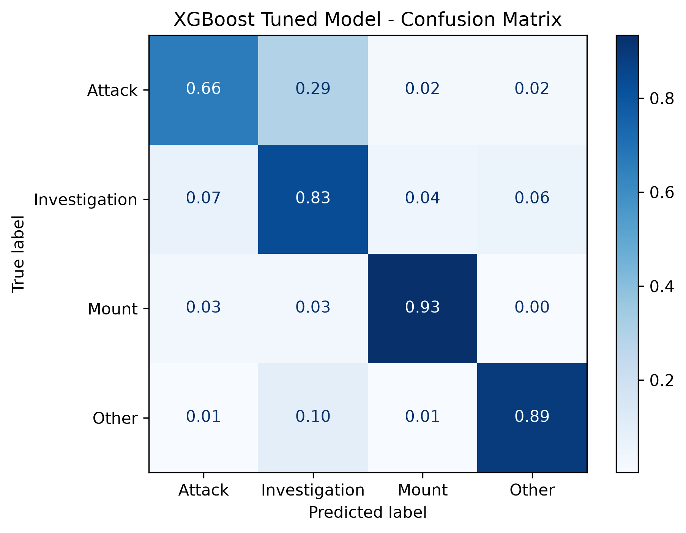
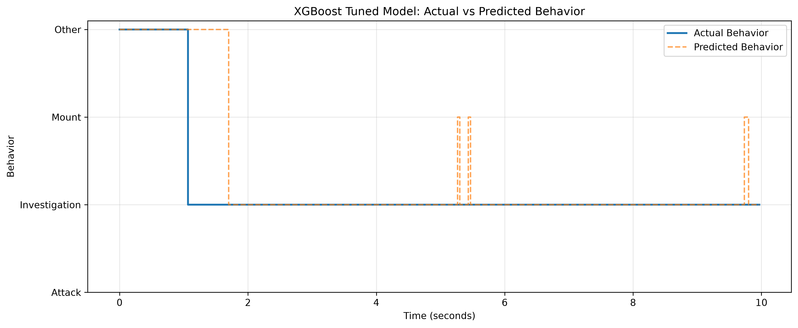

# Mouse Behavior Classification Using XGBoost

An independent machine learning project using Caltech's CalMS21 dataset to classify mouse social behaviors from pose-tracking data.

I developed an XGBoost classification pipeline to distinguish between four behaviors: attack, investigation, mounting, and other activity. Starting with raw body-landmark coordinates, I engineered additional features describing movement velocity, inter-animal distance, anatomical relationships, and short-term movement patterns.

The final model achieved **86.98% validation accuracy and a macro F1-score of 79.56%** across 92,170 labeled frames from 14 held-out recordings.

The purpose of this project is not to introduce a new behavioral classification algorithm. It is to investigate how different representations of animal movement affect classification performance, and to understand the challenges of extracting meaningful behavior from pose-estimation data.

## 1. Where the Data Came From

**Dataset:** Caltech Mouse Social Interactions Dataset (CalMS21)

**Source:** California Institute of Technology

**Original research:** CalMS21: A Benchmark for Measuring the Performance of Automated Behavior Classifiers

**Dataset link:** https://data.caltech.edu/records/s0vdx-0k302

CalMS21 contains pose-tracking measurements of pairs of mice during social interactions. Each recording provides the locations of anatomical landmarks across video frames, along with human-annotated behavioral labels.

I used the classic behavior-classification training data provided in the dataset.

The dataset's pose-estimation and behavioral annotations were produced by the original researchers. I did not collect the videos, track the animals from raw footage, or create the behavioral annotations.

My contribution was implementing the feature-engineering, classification, evaluation, and visualization pipeline using the existing tracking data.

The original dataset is not redistributed in this repository. It can be obtained from the CalMS21 repository.

## 2. Exactly What Data I Analyzed

The training JSON contains 70 recordings under `annotator-id_0`, comprising 507,738 labeled frames.

Each frame contains the tracked positions of seven anatomical landmarks for each of two mice:

1. Nose
2. Left ear
3. Right ear
4. Neck
5. Left hip
6. Right hip
7. Tail base

The keypoint data has the shape:

`(frames, 2, 2, 7)`

The dimensions represent the number of frames, two mice, x/y coordinates, and seven anatomical landmarks.

Flattening the coordinates produces 28 numerical position features per frame.

### Behavior distribution

| Behavior | Frames | Percentage |
|---|---:|---:|
| Attack | 14,039 | 2.77% |
| Investigation | 146,615 | 28.88% |
| Mount | 28,615 | 5.64% |
| Other | 318,469 | 62.72% |
| **Total** | **507,738** | **100%** |

The dataset is substantially imbalanced.

Attack represents fewer than 3% of all annotated frames, while Other represents nearly 63%. A classifier could achieve deceptively high accuracy by prioritizing the majority class.

For this reason, I tracked macro F1-score alongside accuracy and applied class-balanced sample weights during XGBoost training.

### Training and validation split

I split the data at the recording level instead of randomly splitting individual frames.

| Partition | Recordings | Frames |
|---|---:|---:|
| Training | 56 | 415,568 |
| Validation | 14 | 92,170 |

The split was generated using `train_test_split` with `test_size=0.2` and `random_state=42`.

Splitting by recording matters because consecutive video frames are highly correlated. Randomly distributing frames from the same recording between training and validation would allow the model to learn from nearly identical observations in both sets.

All reported results below come from this recording-level validation split.

## 3. What I Did With the Data

I developed the model through four stages:

1. Establish an XGBoost classifier using raw pose coordinates and basic movement measurements.
2. Add anatomical interaction features describing the relative positions of the mice.
3. Introduce temporal features capturing movement across consecutive frames.
4. Compare XGBoost hyperparameter configurations.

Each stage retained the same training and validation recordings, allowing the effects of feature engineering and parameter changes to be compared.

### Stage 1 — Initial XGBoost classification

The initial model used 31 input features:

- 28 raw body-position coordinates
- Mouse 0 movement speed
- Mouse 1 movement speed
- Neck-to-neck distance between the mice

The movement speeds were calculated from the Euclidean displacement of each mouse's neck between consecutive frames, multiplied by the recording frame rate of 30 FPS.

The distance feature was calculated from the Euclidean separation of the two neck landmarks.

I trained an XGBoost classifier with the following parameters:

| Parameter | Value |
|---|---:|
| Number of trees | 200 |
| Maximum tree depth | 6 |
| Learning rate | 0.05 |
| Subsample ratio | 0.8 |
| Feature subsample ratio | 0.8 |
| Tree construction method | hist |

I also used balanced sample weights to account for the unequal number of examples in each behavior category.

**Initial results:**

- Validation accuracy: 81.32%
- Macro F1-score: 72.08%

The initial model demonstrated that pose coordinates and basic movement features could support behavioral classification, but it did not explicitly describe several important relationships between the two animals.

### Stage 2 — Anatomical interaction features

I added three features:

1. Nose-to-nose distance
2. Mouse 0 nose to Mouse 1 neck distance
3. Mouse 1 nose to Mouse 0 neck distance

This expanded the feature set from 31 to 34.

The motivation was that social behaviors depend not only on the absolute positions of animals, but also on their positions relative to one another.

For example, two mice may be separated by the same neck-to-neck distance while facing different directions or positioning their noses near different parts of one another's bodies.

These additional features provide more explicit information about proximity and interaction.

**Results with 34 features:**

- Validation accuracy: 84.73%
- Macro F1-score: 75.70%

Adding three anatomical distance features improved accuracy by 3.41 percentage points and macro F1-score by 3.62 percentage points.

This was the first substantial improvement in the project.

### Stage 3 — Temporal movement features

The next limitation was that most features described individual frames.

Animal behavior, however, is inherently temporal. A short movement can have different interpretations depending on the movements immediately preceding it.

I added five features:

| Feature | Measurement |
|---|---|
| Mouse 0 rolling speed | Mean speed across the current and previous four frames |
| Mouse 1 rolling speed | Mean speed across the current and previous four frames |
| Rolling mouse distance | Mean neck-to-neck distance over five frames |
| Distance change | Change in neck-to-neck distance between consecutive frames |
| Mouse 0 acceleration | Change in Mouse 0's speed between consecutive frames, scaled by FPS |

These features expanded the model to 39 inputs.

The rolling averages use only the current and previous frames. They are calculated separately within each recording to avoid mixing information across recording boundaries.

This provided the model with short-term information about whether the mice were accelerating, maintaining proximity, or moving closer together or farther apart.

**Results with 39 features:**

- Validation accuracy: 85.77%
- Macro F1-score: 77.91%

Compared with the 34-feature model, temporal feature engineering increased accuracy by another 1.04 percentage points and macro F1-score by 2.21 percentage points.

The Attack F1-score improved from approximately 0.45 to 0.53, indicating better performance on the least frequent behavioral class.

### Stage 4 — Hyperparameter experiments

After completing feature engineering, I compared three XGBoost configurations using the same 39-feature dataset.

| Parameter | Baseline | Experiment A | Experiment B |
|---|---:|---:|---:|
| Trees | 200 | 350 | 350 |
| Maximum depth | 6 | 5 | 8 |
| Learning rate | 0.05 | 0.03 | 0.03 |
| Subsample | 0.8 | 0.8 | 0.8 |
| Column subsample | 0.8 | 0.8 | 0.8 |

The goal was to determine whether increasing model capacity and adjusting the boosting rate would improve classification.

Each configuration was trained on the same 415,568 frames and evaluated on the same 92,170 validation frames.

| Configuration | Accuracy | Macro F1 |
|---|---:|---:|
| Baseline | 85.77% | 77.91% |
| Experiment A | 85.46% | 77.62% |
| **Experiment B** | **86.98%** | **79.56%** |

Experiment B performed best on both metrics.

Its deeper trees may have helped capture interactions between anatomical distances, movement speeds, and temporal features.

Because tree depth, learning rate, and the number of boosting iterations changed together, these experiments do not establish which individual parameter caused the improvement.

Experiment B was selected as the final model based on validation macro F1-score.

## 4. What I Found

### Overall model development

| XGBoost model | Features | Accuracy | Macro F1 |
|---|---:|---:|---:|
| Initial model | 31 | 81.32% | 72.08% |
| Anatomical distance features | 34 | 84.73% | 75.70% |
| Temporal features | 39 | 85.77% | 77.91% |
| **Tuned final model** | **39** | **86.98%** | **79.56%** |

Across the experiments, validation accuracy increased by 5.66 percentage points, while macro F1-score increased by 7.48 percentage points.

The largest single accuracy improvement came from introducing anatomical interaction distances.

Temporal features contributed additional gains, particularly for Attack classification.

Hyperparameter tuning provided a further improvement after the feature set was finalized.

These results suggest that explicitly representing relationships between animals and their short-term movement patterns can be useful for frame-level behavior classification.

They do not establish that the same improvements will generalize equally well to new recordings outside the development dataset.

### Final classification performance

The selected XGBoost model achieved:

**Validation accuracy: 86.98%**

**Macro F1-score: 79.56%**

| Behavior | Precision | Recall | F1-score | Validation frames |
|---|---:|---:|---:|---:|
| Attack | 0.48 | 0.66 | 0.55 | 3,490 |
| Investigation | 0.79 | 0.83 | 0.81 | 27,529 |
| Mount | 0.86 | 0.93 | 0.90 | 10,161 |
| Other | 0.96 | 0.89 | 0.93 | 50,990 |

The model performed best on Other and Mount, with F1-scores of 0.93 and 0.90 respectively.

Attack remained the most difficult class.

Although the model correctly identified approximately 66% of actual attack frames, its precision was only 48%. This indicates that a substantial number of frames predicted as Attack actually belonged to another class.

### Confusion matrix



**Figure 1. Normalized confusion matrix for the final 39-feature XGBoost model.** Rows correspond to human-annotated behaviors, while columns show the model's predictions. Each row is normalized by the number of frames belonging to that true class.

The diagonal represents correctly classified frames.

The model correctly identified approximately:

- 65.8% of Attack frames
- 83.0% of Investigation frames
- 93.4% of Mount frames
- 89.3% of Other frames

The largest misclassification pattern involved Attack and Investigation.

Approximately 29.5% of frames labeled Attack were predicted as Investigation.

This suggests that the model has difficulty distinguishing some aggressive interactions from investigatory movements using the available pose and temporal features.

The confusion matrix also shows that approximately 9.6% of Other frames were classified as Investigation.

These errors indicate that temporal movement and anatomical proximity are informative, but do not fully resolve behaviors with overlapping physical characteristics.

### Actual vs. predicted behavior



**Figure 2. Human-annotated behavior compared with XGBoost predictions over approximately 10 seconds of a validation recording.** The solid line represents ground-truth annotations, while the dashed line represents model predictions.

The segment begins with Other behavior and transitions to Investigation after approximately one second.

The model initially continues predicting Other after the annotated transition, introducing a short delay before recognizing Investigation.

For most of the remaining segment, the predictions agree with the annotations.

However, the model also produces several brief Mount predictions while the true behavior remains Investigation.

These short fluctuations demonstrate an important limitation of frame-level classification.

Even with temporal features, the model predicts each frame independently rather than explicitly enforcing continuity between consecutive behavioral labels.

A temporal sequence model or post-processing method could potentially reduce these fluctuations, although this has not been tested in the current project.

## 5. Tools and Libraries

The project was implemented in Python using open-source libraries.

| Library | Purpose |
|---|---|
| NumPy | Pose-coordinate processing, distances, velocities, and temporal calculations |
| XGBoost | Gradient-boosted decision-tree classification |
| Scikit-learn | Recording-level splitting, class weights, and evaluation metrics |
| Matplotlib | Confusion matrix and behavioral prediction visualizations |
| json | Reading the CalMS21 annotations |
| zipfile | Accessing the dataset directly from its compressed archive |
| pathlib | Managing output directories |

The final classifier uses XGBoost with the following parameters:

```python
model = XGBClassifier(
    objective="multi:softprob",
    num_class=4,
    n_estimators=350,
    max_depth=8,
    learning_rate=0.03,
    subsample=0.8,
    colsample_bytree=0.8,
    tree_method="hist",
    eval_metric="mlogloss",
    random_state=42,
    n_jobs=-1
)
```

Class-balanced sample weights are calculated from the training annotations and passed during model fitting.

No GPU is required by the current configuration.

## 6. Running the Project

Clone the repository:

```bash
git clone https://github.com/Crazycoder612/CalMS21-Behavior-Classification.git
cd CalMS21-Behavior-Classification
```

Install the Python dependencies:

```bash
python -m pip install numpy scikit-learn xgboost matplotlib
```

Download the CalMS21 classic behavior-classification dataset from:

https://github.com/caltechvisionlab/CalMS21

Place the downloaded archive at:

```text
data/task1_classic_classification.zip
```

Run the project:

```bash
python Main.py
```

The script loads the data, constructs the features, trains and evaluates three XGBoost configurations, selects the configuration with the highest validation macro F1-score, and generates the evaluation plots.

The selected model is saved to:

```text
models/mouse_behavior_xgboost_tuned.json
```

The figures are saved in the `results/` directory.

## 7. Limitations

### Validation results are not independent test results

The final accuracy of 86.98% and macro F1-score of 79.56% were measured on the 14-recording validation split.

This validation set was used repeatedly during feature engineering and hyperparameter selection.

Consequently, the final reported numbers may be optimistic estimates of performance on completely unseen recordings.

An independent evaluation using untouched labeled recordings would be necessary before treating these values as final test performance.

### Attack classification remains difficult

Attack was the least frequent class in the training data, representing approximately 2.54% of training frames.

Despite balanced sample weights and additional movement features, the final model achieved an Attack F1-score of only 0.55.

The confusion matrix shows that Attack was frequently confused with Investigation.

Additional features describing body orientation, relative motion, and longer behavioral sequences may help, but these possibilities have not been evaluated.

### Predictions do not enforce behavioral continuity

The model uses short-term temporal features but does not explicitly model transitions between behavioral states.

Individual predictions may fluctuate over short intervals even when the annotated behavior remains constant.

Sequence-based approaches could potentially address this limitation.

### Pose estimates and annotation quality are inherited

The project uses the keypoints and annotations provided by CalMS21.

I did not independently verify the original pose estimates or behavioral labels against raw videos.

Tracking errors and ambiguity in human annotations may therefore affect model performance.

### The project does not characterize anesthesia

CalMS21 concerns mouse social interactions, not responses to anesthetic agents.

Although the feature-engineering and classification techniques could be relevant to broader animal-behavior research, this model was not trained or validated to determine anesthetic depth, reflex suppression, or physiological states.

## 8. What I Would Investigate Next

Several questions remain unresolved.

**Can additional orientation features improve Attack classification?**

The existing model uses distances between selected anatomical landmarks but does not explicitly quantify the direction each mouse is facing.

Features based on head orientation, body angles, and relative movement direction may help distinguish approach and investigation from aggressive interactions.

**Would longer temporal windows improve behavioral recognition?**

The current rolling averages span five frames.

A longer temporal context might help distinguish sustained behavioral sequences from isolated movements, although larger windows could also blur rapid transitions.

**Would a sequence model reduce prediction fluctuations?**

Models that learn relationships across consecutive frames might produce smoother predictions and better distinguish behavioral sequences.

This could be investigated using temporal convolutional networks, recurrent models, or other sequence-aware approaches.

**How well does the final model generalize to independent recordings?**

This is the most important remaining question.

A genuinely independent labeled evaluation set would provide stronger evidence of performance beyond the recordings used during development.

## 9. Files in This Repository

```text
CalMS21-Behavior-Classification/
├── README.md
├── Main.py
├── data/
│   └── task1_classic_classification.zip
├── models/
│   └── mouse_behavior_xgboost_tuned.json
└── results/
    ├── xgboost_tuned_confusion_matrix.png
    └── xgboost_tuned_predictions.png
```

`Main.py` implements dataset loading, feature engineering, hyperparameter experiments, evaluation, and visualization.

`mouse_behavior_xgboost_tuned.json` contains the selected trained XGBoost model.

`xgboost_tuned_confusion_matrix.png` visualizes class-level performance.

`xgboost_tuned_predictions.png` compares predictions with annotated behavior over a short validation segment.

The dataset ZIP is shown for local execution but is not intended to be committed to the repository. Users should obtain it from the original CalMS21 source.

## 10. Conclusion

This project investigated whether anatomical and temporal feature engineering could improve XGBoost classification of mouse social behavior.

Starting with 31 position- and movement-based features, I introduced relative anatomical distances and short-term temporal measurements, increasing the feature set to 39.

I then compared three XGBoost hyperparameter configurations and selected the best-performing model.

The final classifier achieved 86.98% validation accuracy and a macro F1-score of 79.56%, compared with 81.32% accuracy and 72.08% macro F1 for the initial XGBoost model.

The central result is that explicitly describing interactions between animals and their movement over time improved classification performance on the validation recordings.

The remaining challenge is establishing how well those improvements generalize beyond the data used for model development.

## References

Caltech Vision Lab. CalMS21: A Benchmark for Measuring the Performance of Automated Behavior Classifiers.

Dataset and documentation: https://github.com/caltechvisionlab/CalMS21
